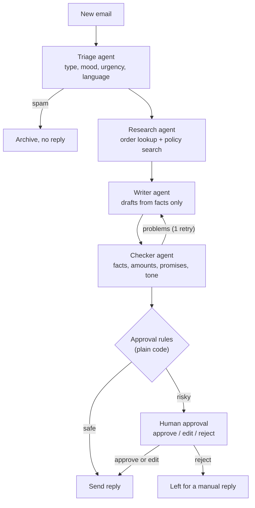

# InboxPilot: an AI agent team for a small shop's support inbox

A team of AI agents reads every customer email, looks up the order, checks the shop's policies, drafts a reply and checks it. Simple questions are answered automatically. **Anything involving money, an upset customer or legal risk waits for a human to approve it.**

**Live demo:** _link coming soon_  
**Built by:** Bharti Shrivastava, AI automation engineer. [Hire me on Contra](https://contra.com/bharti_shrivastava_zu3hypce) to set this up for your inbox.

---

## The problem it solves

A small online shop's owner can spend hours a day on the same emails: *Where is my order? Can I return this? Do you ship to Canada?* Hiring support staff is expensive, and a chatbot that answers on its own can promise refunds the business never offered.

InboxPilot drafts every reply from the shop's real order data and written policies, sends the safe ones, and puts the risky ones in front of the owner with the reason, ready to approve, edit or reject in one click.

## Try it

The demo uses **Saffron & Thread**, a *fictional* handloom shop, with 7 made-up orders and 15 sample emails: order tracking, returns, a torn bedsheet, a furious customer threatening consumer court, a hotel asking for 60 bedsheets, a Hinglish message, spam and a phishing email. You can also write your own email.

| Email | What happens |
|---|---|
| "Where is my order ST-10482?" | Sent automatically with the ship date, tracking number and expected date |
| "Can I return the jute rug from the sale?" | Sent automatically: Final Sale means exchange only, no refund |
| "Bedsheet arrived torn, refund ₹4,800" | Waits for approval: refund above the ₹2,000 limit |
| "Third email… consumer court" | Waits for approval, owner alerted: upset customer, legal threat |
| "60 bedsheets for our hotel" | Waits for approval, owner alerted: sales lead |
| "Boost your SEO ranking 300%" | Archived as spam, no reply |

## Results

25 labelled emails: 15 main ones and 10 held-out ones with new wording that were never used to tune anything. "Risky" means the email should never be answered without a human.

<!-- RESULTS:START -->
_Run `python eval/run_eval.py` with a Gemini key to fill in this table._
<!-- RESULTS:END -->

## How the agents work together



Built with **LangGraph**: each agent is a node in a state graph, the checker can send a draft back to the writer, and the approval step uses LangGraph's `interrupt()` with a checkpointer. The run pauses, saves its state, and resumes exactly where it stopped when the owner decides. The agents use **Gemini** through **LangChain**, with structured output for triage and review. The interface is **Streamlit**.

## Why it's safe to let it answer customers

- **The rules decide, not the AI.** Whether a reply can go out is decided in plain Python: refunds over ₹2,000, cancellations, sales leads, upset customers, legal threats, unknown order numbers and failed checks always go to a human.
- **Facts come from data, not memory.** Delivery dates, return windows, Final Sale status and refund eligibility are calculated in code from the order and handed to the writer.
- **Every draft is checked twice.** Code checks every ₹ amount and order number against the order data and policies, and blocks refund promises the policy doesn't allow. Then an AI checker reviews tone and accuracy. A bad draft gets one rewrite, then goes to a human.
- **Order numbers are read from the email text**, never guessed by the model.
- **Spam and phishing never get a reply.**

## Run it on your computer

You need Python 3.10 or newer and a free Gemini API key from [Google AI Studio](https://aistudio.google.com/apikey).

```bash
git clone <this repository's URL>
cd support-inbox-agents
python -m venv .venv
# Windows: .venv\Scripts\activate     macOS/Linux: source .venv/bin/activate
pip install -r requirements-dev.txt
cp .env.example .env        # Windows: copy .env.example .env   then paste your key into .env
python scripts/check_setup.py
streamlit run app.py
```

Without a key the app runs in **rules-only mode**: keyword rules and reply templates stand in for Gemini, so you can look around first.

```bash
pytest                       # 52 tests, no key needed
python eval/run_eval.py      # rules-only vs Gemini agents, writes eval/results.md (about 10 minutes)
```

## Project structure

```
app.py                 Streamlit review screen: inbox, agent trace, approve / edit / reject
inboxpilot/
  agents.py            the agent nodes and routing
  graph.py             LangGraph wiring, human approval with interrupt(), checkpointer
  rules.py             order facts, approval rules and draft checks (no AI)
  brains.py            Gemini via LangChain, plus the rules-only stand-in
  knowledge.py         order lookup and policy search (BM25)
  outbox.py            where approved replies and owner alerts go
data/                  fictional orders, policies and 25 labelled emails
eval/run_eval.py       the evaluation
tests/                 unit tests and full-workflow tests
```

## Limitations

- Nothing is really emailed. Connecting Gmail or Outlook, and a real order system such as Shopify, is the next step for a live shop.
- The approval state is kept in memory, so waiting tickets are lost when the app restarts. A live setup would use LangGraph's SQLite or Postgres checkpointer.
- 25 emails is a small test set. It shows how the approaches compare, not how every inbox will behave.
- The ₹2,000 limit and the other rules are examples; each business sets its own.

## Want this for your business?

I build AI agent workflows like this for small businesses, connected to your inbox, your order system and your own rules. [Message me on Contra](https://contra.com/bharti_shrivastava_zu3hypce).

---

MIT licensed. Saffron & Thread, its customers and orders are fictional and exist only for this demo.
